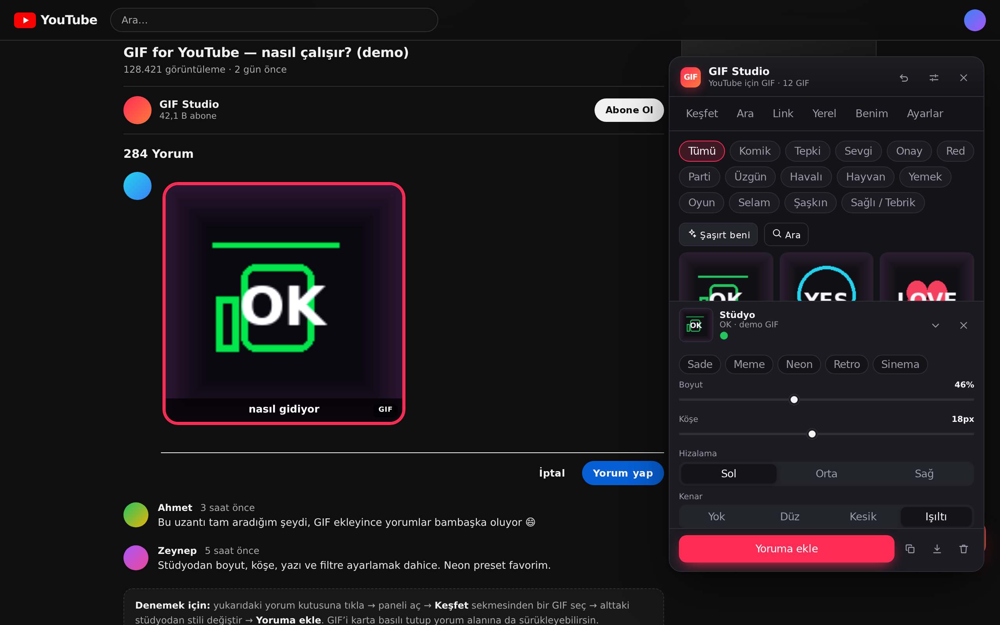
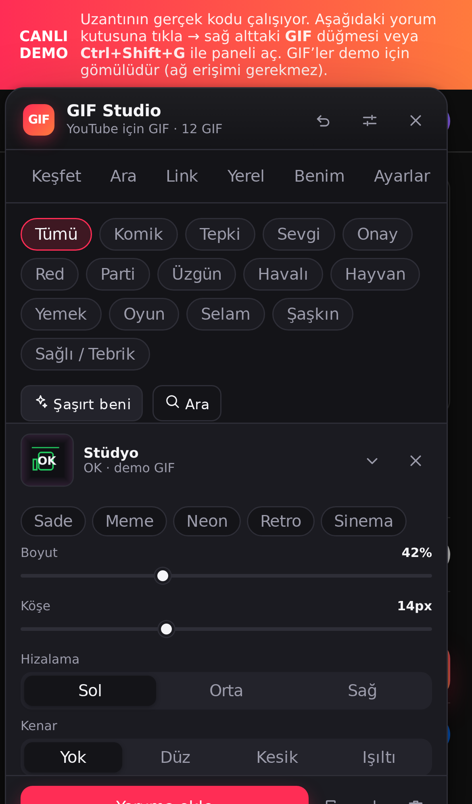

# GIF for YouTube — GIF Studio  ·  v1.1.1

YouTube yorumlarına **GIF ekleyen** Chrome uzantısı (Manifest V3, Türkçe/İngilizce).
335 GIF'lik doğrulanmış hazır tepki paketi, Giphy arama, link çözümleme, yerel GIF desteği,
**canlı çerçeveleme stüdyosu** (boyut · köşe · kenar · gölge · yazı · filtre) ve en önemlisi:
**yayınlandıktan sonra kaybolmayan** kalıcı GIF kodu (`:gfy:<id>:`).

> **Bu depo hazır bir uzantıdır.** `gif-for-youtube` klasörünü Chrome'a yükle, çalışır.



<p align="center"></p>

---

## 1. Kurulum (30 saniye)

1. Chrome'da `chrome://extensions` adresini aç.
2. Sağ üstten **Geliştirici modu**nu aç.
3. **Paketlenmemiş öğe yükle** → bu klasörü (`gif-for-youtube`) seç.
4. Herhangi bir YouTube sayfasını aç. Sağ altta **GIF** düğmesi görünür.

Kurulumdan sonra ayarlar sayfası otomatik açılır (`options/options.html`).

**Uzantıyı kurmadan denemek için:** `demo/gif-for-youtube-demo.html` dosyasını çift tıkla
(tek dosya, 613 KB — tüm kod ve GIF'ler gömülü, ağ gerekmez). Uzantının **gerçek** panel,
editör ve stüdyo kodu çalışır; yalnızca `chrome.*` API'leri ve arama sonuçları taklit edilir.
`demo/demo.html` ise aynı demoyu modüler dosyalarla çalıştırır (geliştirme için).

---

## 2. Kullanım

| Adım | Ne yapılır |
|---|---|
| 1 | Yorum kutusuna **tıkla** (imleç görünsün) |
| 2 | **Ctrl+Shift+G** ya da sağ alttaki **GIF** düğmesi |
| 3 | **Keşfet**'ten kategori seç, **Ara**'da Giphy'de ara, **Link**'ten URL yapıştır ya da **Yerel**'den dosya sürükle |
| 4 | Alttaki **Stüdyo**'dan boyut/köşe/yazı/filtre ayarla (değişiklikler anında uygulanır) |
| 5 | **Yoruma ekle** — GIF imlecin olduğu yere yerleşir |

GIF'i karttan **tutup yorum alanına sürükleyebilirsin**; imleç bıraktığın noktaya gider.

### Kısayollar

| Kısayol | İşlev |
|---|---|
| `Ctrl+Shift+G` | Paneli aç / kapat |
| `Ctrl+Shift+Y` | Son kullandığın GIF'i ekle |
| `/` | Arama sekmesine geç |
| `←/→/↑/↓` · `Enter` | Kartlar arasında gezin · ekle |
| `Esc` | Kapat |

Kısayollar `chrome://extensions/shortcuts` üzerinden değiştirilebilir.

---

## 3. Özellikler

**Arama ve kaynak**
- 335 GIF / 14 kategori hazır paket (hepsi HTTP 200 + geçerli GIF başlığı ile doğrulandı).
- Üç kademeli arama zinciri: **Giphy API** (anahtarın varsa) → **Giphy web** (anahtarsız) → **hazır paket**.
- Link çözümleme: `giphy.com/gifs/...`, `media.giphy.com/...`, `tenor.com/view/...`, çıplak Giphy ID ve doğrudan `.gif` adresleri.
- Yerel GIF: sürükle-bırak, dosya seç veya panodan yapıştır. **Hiçbir sunucuya yüklenmez** (base64, tarayıcıda kalır).

**Stüdyo (canlı)**
- Boyut (%12–100, genişlik tavanı), köşe yuvarlaklığı, hizalama.
- Kenar: yok / düz / kesik / ışıltı + renk + kalınlık.
- Gölge: yok / yumuşak / sert / neon.
- Yazı: alt yazı, üst/alt konum, BÜYÜK harf, renk, boyut.
- Filtreler: gri ton, doygunluk, kontrast, parlaklık, renk tonu, bulanıklık.
- 5 hazır stil: **Sade · Meme · Neon · Retro · Sinema**.
- "GIF" etiketi, tek tıkla geri al / kaldır, GIF'i kopyala (PNG olarak panoya) / indir.

**Kalıcılık (v1.1.0)**
- Yayınlama köprüsü: submit anında GIF → `:gfy:<id>:` kodu (+ link), başarısız gönderimde otomatik geri alma.
- Okuyucu: yorumlarda/sohbetlerde `:gfy:` kodlarını gerçek GIF'e çevirir (açılıp kapatılabilir).
- Rozet artık CSS ile çizilir → yayınlanan yorumda sızıntı metin yok.

**Arayüz**
- Shadow DOM ile izole panel (YouTube CSS'i ve CSP'si etkilemez), sürüklenebilir, konumu hatırlanır.
- Koyu / açık / otomatik tema, 8 vurgu rengi, hareket azaltma.
- Favoriler, son kullanılanlar, "tepkilerim"; ayarları JSON olarak dışa/içe aktarma.
- Tam klavye erişilebilirliği (rol, aria, odak halkaları, `Esc`), TR/EN arayüz.

---

## 4. Yayınlayınca ne olur? (v1.1.0 ile çözüldü)

Eski sürümde "Yorum yap"a basınca GIF kayboluyor ve geriye sadece **"GIF"** yazısı kalıyordu.
Bunun iki nedeni vardı ve ikisi de düzeltildi:

1. **Rozet metni sızıyordu.** "GIF" etiketi DOM'da gerçek bir metin düğümüydü; YouTube görseli silince
   geriye o yazı kalıyordu. Artık etiket **CSS `::after`** ile çiziliyor → pill'in içinde hiç metin yok.
2. **Yayınlanan yorumda görsel yaşamıyor.** YouTube, gönderilen yorumlardaki `` etiketlerini
   sunucu tarafında temizler. Uzantı artık **"Yorum yap" tıklandığı anda**, YouTube DOM'u okumadan önce
   (capture fazı) GIF'i **kalıcı metne** çeviriyor:

```
:gfy:fHoqSTQTsgSbfUoiTw: https://giphy.com/gifs/fHoqSTQTsgSbfUoiTw
```

Bu kod düz metin olduğu için yorum gönderildikten sonra da yaşar. Uzantıya sahip herkes
yorumu okurken bu kodu **tekrar GIF olarak** görür (`content/render-codes.js`).

| Mod (Ayarlar → Ekleme modu) | Editörde | Gönderilen yorumda | Kim ne görür |
|---|---|---|---|
| **GIF kodu + link** *(varsayılan)* | GIF | `:gfy:ID: https://giphy.com/…` | Herkes linki · uzantısı olanlar GIF'i |
| Sadece önizleme | GIF | kaynak linki | Herkes linki |
| Sadece link | link | link | Herkes linki |

> Yorum gönderilemezse (doğrulama hatası vb.) uzantı 3 saniye içinde GIF'i editöre geri koyar.

### Peki gerçek GIF yorumu mümkün mü?
YouTube, GIF yorumlarını **23 Eylül 2026**'da duyurdu ve **Ekim 2026'dan itibaren yalnızca mobil
uygulamada**, yalnızca **Tenor** kütüphanesinden gelen GIF'lerle açtı. **Masaüstünden (tarayıcıdan)
gönderilen GIF yorumları 14 Ekim 2026'dan beri YouTube tarafından reddediliyor.** YouTube Data API
kayıtlarına göre yorumlara görsel/GIF ekleme (`snippet.imageUrl`) **Kasım 2026'da** tüm kullanıcılara
açılacak. Kaynaklar:

- 9to5Google — *YouTube begins rolling out GIF support for comments* (14 Eki 2026)
- Notebookcheck — *YouTube opens comment section to pictures and GIFs for everyone in November*
- Teknoblog — *YouTube GIF yorumlarını kasımda herkese açıyor*
- rayytor/desktop_gifs — *"Since 14 October 2026 YouTube refuses GIF comments sent from desktop"*

Bu yüzden uzantı iki yolu da destekler:
- **Bugün, tarayıcıda:** kalıcı GIF kodu + link (yukarıdaki tablo).
- **Gerçek GIF yorumu:** panelde **“Tenor'da ara (mobil)”** düğmesi aynı aramayı Tenor'da açar;
  GIF'i kopyalayıp YouTube mobil uygulamasının GIF seçicisinden paylaşabilirsin (mobil uygulama
  yalnızca Tenor GIF'lerini kabul eder). YouTube masaüstü desteğini açtığında uzantı yerel GIF
  ekine geçecek şekilde güncellenecek.

## 5. Mimari

```
gif-for-youtube/
├── manifest.json            MV3 tanımı (permissions, host_permissions, kısayollar)
├── background.js            service worker: arama zinciri, link çözümleme, context menü
├── lib/
│   ├── core.js              saf mantık: link ayrıştırma, geometri, filtre/stil, güvenlik (DOM'suz, test edilebilir)
│   ├── i18n.js              TR/EN sözlük (anahtar eşitliği testli)
│   └── pack.js              335 GIF'lik hazır paket (id, kategori, başlık, ölçü)
├── content/
│   ├── panel-css.js         panel stilleri (shadow DOM, tümü createElement ile kurulur → CSP/Trusted Types güvenli)
│   ├── insert.js            editör bulma, pill üretimi, imlece ekleme, canlı stil uygulama
│   ├── ui.js                panel: sekmeler, ızgara, stüdyo, favoriler, ayarlar
│   ├── main.js              giriş noktası, mesajlar, sürükle-bırak, kısayollar, yayınlama köprüsü
│   └── render-codes.js      yorumlardaki :gfy: kodlarını GIF'e çeviren okuyucu
├── options/                 ayarlar sayfası + canlı önizleme
├── popup/                   araç çubuğu popup'ı (durum, son GIF'ler)
├── demo/demo.html           uzantısız canlı demo (gerçek kodu çalıştırır)
└── test/core.test.js        44 birim testi (Node)
```

**Tasarım kararları**
- *Saf çekirdek*: `lib/core.js` DOM'a dokunmaz → mantık Node'da test edilir, tarayıcıda aynı kod koşar.
- *CSP/Trusted Types uyumu*: YouTube'un `require-trusted-types-for 'script'` politikası `innerHTML`
  kullanımını engeller; bu yüzden tüm panel `createElement` + `textContent` ile kurulur, `innerHTML` hiç kullanılmaz.
- *Dayanıklı medya*: Giphy alan adı `media.giphy.com` → `media1..5` → `i.giphy.com` sırasıyla denenir;
  hepsi başarısızsa baytlar arka planda çekilip `data:` URL olarak gömülür.
- *Güvenlik*: yalnızca `https:` ve `data:image/...` kaynaklarına izin; başlık/yazı metinleri temizlenir;
  `javascript:` şemaları reddedilir; `<all_urls>` **istenmez** (yalnızca YouTube + Giphy/Tenor host'ları).

---

## 7. Geliştirme ve test

```bash
# 36 birim testi (tarayıcı gerekmez)
cd gif-for-youtube && node test/core.test.js

# paketleme
cd .. && zip -r gif-for-youtube-v1.0.0.zip gif-for-youtube -x "*.DS_Store"
```

### Doğrulama (bu depoda gerçekten çalıştırıldı)

| Test | Sonuç |
|---|---|
| `node test/core.test.js` — 44 birim testi | ✅ hepsi geçti |
| 335 GIF'in medya URL'si (HTTP + GIF başlığı) | ✅ 335/335 geçerli |
| Demo sayfası (Playwright, Chromium) | ✅ panel, 6 sekme, ekleme, canlı stil, arama, `Esc` — konsol hatası yok |
| **Gerçek uzantı yüklemesi (Chromium + `--load-extension`)** | ✅ service worker kaydı, içerik betiği enjeksiyonu, 120 kartın Giphy'den yüklenmesi (8/8 örnek), panelden arama (24 sonuç), GIF'in `contenteditable` içine eklenmesi (260×260, `contenteditable="false"`, GIF etiketi), `chrome.storage` kalıcılığı (1 geçmiş, 1 sayaç), canlı boyut 260→480px, `Esc` ile kapanma |
| Ayarlar + popup sayfaları | ✅ 29 ayar satırı, canlı önizleme (105→213px), switch'ler; popup durum göstergesi |
| **Mobil emülasyon (iPhone 13, gerçek uzantı):** panel alt-sheet olarak sığıyor (390×571), ekleme sonrası otomatik kapanıyor, seçim korunuyor, yayınlanan metin `:gfy:…: link` | ✅ |
| **Yayın testi (v1.1.0+):** YouTube taklidi sayfada GIF ekle → "Yorum yap" | ✅ gönderilen metin `:gfy:ID: https://giphy.com/…`; `` yok, sızan "GIF" yazısı yok; yorum akışında kod tekrar **GIF olarak** yüklendi (naturalWidth>0) |

Test betikleri: `../tools/test_demo.py`, `../tools/e2e_extension.py`, `../tools/e2e_publish.py`, `../tools/test_pages.py`.

---

## 8. Sorun giderme

| Belirti | Çözüm |
|---|---|
| "Yorum alanı bulunamadı" | Önce yorum kutusuna tıkla; YouTube editörü yeniden oluşturduysa paneli kapat/aç |
| GIF yüklenmiyor | Kurumsal ağ/DNS Giphy'yi engelliyor olabilir; **Yerel** sekmesinden dosya sürükle |
| Arama boş | `Ayarlar → Giphy API anahtarı` (ücretsiz, developers.giphy.com) ekle |
| Panel görünmüyor | Sayfayı yenile; `Ctrl+Shift+G`; sağ alttaki GIF düğmesi kapalıysa ayarlardan aç |
| GIF gönderdikten sonra kayboldu | v1.1.0'da çözüldü: "GIF kodu + link" modu kullan (bkz. §4) |
| Yorumda `:gfy:...:` metni göründü | Karşı taraf uzantıyı kullanmıyor. Link yine tıklanabilir; GIF'i görmek için uzantı gerekir |

---

## 9. Gizlilik

- Hiçbir analitik, izleme veya uzak sunucu yok. Arama istekleri doğrudan Giphy'ye gider.
- Ayarlar, favoriler, geçmiş yalnızca `chrome.storage.local` içinde tutulur.
- Yerel GIF dosyaları yüklenmez; base64 olarak yalnızca senin tarayıcında saklanır.
- Giphy API anahtarı (girersen) yalnızca cihazında saklanır.
- Ayrıntılar: `PRIVACY.md`.

## 10. Lisans ve içerik

Kod: MIT. GIF içeriği Giphy üzerinden sunulur ve [Giphy kullanım koşullarına](https://giphy.com/terms) tabidir.
Yerleşik paket yalnızca herkese açık Giphy GIF'lerinin kimliklerini içerir; medya Giphy CDN'inden yüklenir.
Bu uzantı YouTube ile resmî bağlantılı değildir; YouTube markası kendi sahibine aittir.
